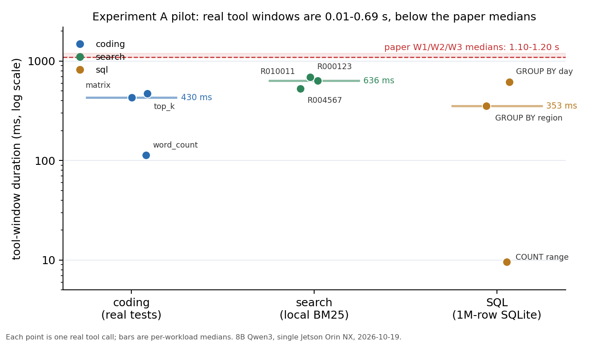

# 实验 A 试点：真实 agent 负载的准备机会（2026-10-19）

## 1. 结论

**机会是真实的，但比论文当前的中位数假设更紧、更依赖具体查询/任务。**

- 9 次真实工具调用的窗口为 **9.6 ms–691 ms**，中位 **473 ms**；按 workload 中位为 coding 430 ms、search 636 ms、SQL 353 ms。
- 论文 Fig.5 的 W1 中位 **1.096 s**、W2/W3 **~1.20 s**，本轮实测中位约为其 **35–60%**。同一 workload 内可相差近两个数量级（SQL `COUNT` 9.6 ms vs `GROUP BY day` 618 ms）。
- 8B 模型在三类任务上都只调用一次工具就完成，因此单 episode 的累计窗口只有 0.01–0.69 s；论文 W1 是 5 轮 × 1.096 s（约 5.5 s）。**本轮不能回答累计机会**，需要多轮任务。
- 工具时间只占 episode wall 的 **0.43–0.65%**，因为边缘设备上生成占绝对主导；机会应相对“准备一个候选的成本”衡量，而不是相对 episode wall。



## 2. 方法

### 硬件与模型

- 单台 Jetson Orin NX（nx1，16 GB），Qwen3-8B Q40，`dllama-api` 单机，context 2048，`--nthreads 8`，temperature 0，seed 42。
- 选择 8B 而不是论文的 14B 5 机：14B 5 机在本轮出现 nano1/nano2 OOM 与首请求超时，3 机 14B 的生成速度约 0.8 token/s，无法在合理时间内跑完试点。**本试点只用于测量工具侧机会，不用于比较生成性能。**
- Qwen3 使用 `/no_think` 并在解析前剥离 `<think>` 块；不剥离时模型输出会导致 JSON 解析失败。这是 harness 行为，不是任务答案干预。

### 真实工具

| workload | 工具 | 实现 | 参考耗时 |
|---|---|---|---|
| coding | `run_tests(task, code)` | 写入临时目录，macOS `sandbox-exec` 限制写/网络，子进程跑隐藏测试；测试含真实数据规模 | 正确解 75–451 ms |
| search | `search_docs(query)` | 120,000 篇本地文档的 BM25，返回 top-3 | 宽查询 0.53–0.82 s；唯一 token 查询 0.57 ms |
| SQL | `sql_query(query)` | 1,000,000 行只读 SQLite（20 个 region，2025 年日期） | 索引 COUNT 9.6 ms；全表 GROUP BY 353–832 ms |

### 任务与约束

- 每类 3 个任务：coding（word_count / top_k / matrix，隐藏测试 2 项）、search（查 region 的首府）、SQL（最高 region、日期范围计数、最高日期）。
- 要求至少调用一次工具后才能 `final_answer`；重复相同工具调用会被提示，不执行第二次。
- 记录每次 generation 的请求/响应时间、每次 tool 的起止时间、API 的 `edgevisor` token lineage、最终答案和工具结果。

## 3. 结果

### 3.1 工具窗口

| workload | n | 中位 | 最大 | 说明 |
|---|---:|---:|---:|---|
| coding | 3 | 430 ms | 473 ms | word_count 113 ms；matrix 430 ms；top_k 473 ms |
| search | 3 | 636 ms | 691 ms | 同一宽查询模板，530–691 ms |
| SQL | 3 | 353 ms | 618 ms | COUNT 9.6 ms；GROUP BY region 353 ms；GROUP BY day 618 ms |
| 全部 | 9 | 473 ms | 691 ms | 范围 9.6–691 ms |

### 3.2 Episode 级

| workload | episodes | 完成 | tool calls | tool 时间中位 | episode 中位 | tool 占比 |
|---|---:|---:|---:|---:|---:|---:|
| coding | 3 | 3/3（测试全过） | 3 | 430 ms | 96.7 s | 0.43% |
| search | 3 | 2/3（一次连接 reset） | 3 | 636 ms | 105.7 s | 0.65% |
| SQL | 3 | 3/3（答案正确） | 3 | 353 ms | 71.5 s | 0.51% |

- coding 的三个解均一次通过 2/2 隐藏测试。
- SQL 三个答案分别为 `R05`、`83334`、`2025-11-27`，与数据库查询结果一致。
- search 第三次在工具返回后隧道被重置（`Connection reset by peer`），不是工具错误；该次工具窗口仍被记录。

### 3.3 关键观察

1. **查询/任务选择性主导窗口长度**。SQL 的 `COUNT` 走索引 9.6 ms，而全表 `GROUP BY day` 618 ms；search 的宽查询 0.5–0.8 s，而唯一城市 token 查询 0.57 ms。用单一中位数（1.096 s）做调度输入会同时高估简单查询、低估复杂查询。
2. **本轮的中位数低于论文**。论文 W1 1.096 s、W2/W3 ~1.20 s；本轮 coding 430 ms、search 636 ms、SQL 353 ms。可能原因：本地工具无网络、测试规模小于论文、任务一轮完成、8B 单机而非 14B 5 机。需要 14B/5 机与远程工具复核，不能直接把本轮数字外推为论文结论。
3. **累计机会未被测量**。每 episode 只有 1 次工具调用；论文 W1 有 5 个窗口。要回答“一个 episode 能攒多少准备时间”，必须设计 3–5 轮的多轮任务（例如带隐藏 bug 的 coding、分步检索、迭代 SQL）。
4. **tool 占比很小，但不是正确的分母**。生成占 99% 以上，准备只需要在窗口内与工具并行；关键比较是“窗口长度 vs 准备一个候选的耗时”，而不是“tool 时间 / episode wall”。

## 4. 限制

- 单机 8B，不是论文的 14B 五设备；生成时间和 decode bubble 不可比。工具窗口是 workload 侧量，理论上与模型无关，但仍需 14B/5 机复核。
- 9 次工具调用、3 个任务/类、每 episode 仅 1 次调用；样本不足以估 p95，也不能代表多轮 agent 的累计机会。
- 工具为本地实现，没有网络/远程 API 延迟；论文的 1.1–1.2 s 可能包含远程工具或网络，需单独测。
- coding 测试规模是人为设定的真实计算负载，不是某个具体项目的测试套件；不同项目差异会很大。
- 单机没有 pipeline，decode bubble 未测；这属于实验 A 的第二部分。
- 14B 五机在本轮未跑通：nano1/nano2 在 2048 context 下 OOM；重分配后首请求仍超时。14B 3 机生成约 0.8 token/s，不适合本轮试点。

## 5. 对论文的含义

- 不应把“1.096 s / 1.20 s”写成普适的工具窗口中位数；应报告**分布**和**查询/任务依赖性**，并说明测量条件（本地/远程、测试规模、轮数）。
- 机会存在（百毫秒级），但比论文假设更紧；admission/JIT 的收益模型应使用**逐窗口/逐查询的估计**，而不是固定中位数。
- 下一步必须先补多轮任务与 14B/5 机，再谈 B 的端到端收益；否则 B 的“准备机会”输入不可信。

## 6. 证据与复现

- Harness：`scripts/experiments/opportunity_study.py`（本次提交）。
- Fixtures：`work/opportunity_20261019/fixtures/`（120k 文档、1M 行 SQLite、6 个 coding 测试；不在 Git）。
- 原始 episodes：`work/opportunity_20261019/runs/pilot_8b_{coding4,search3,sql3}/`（含 `episode.json`、`summary.json`）。
- 图：`docs/test_records/assets/experiment_a_tool_windows_20261019.png`。
- 复现：
  ```bash
  python3 scripts/experiments/opportunity_study.py --prepare-fixtures
  python3 scripts/experiments/opportunity_study.py \
    --api-url http://127.0.0.1:19690/v1 \
    --workloads coding,search,sql --limit 3 --max-turns 5 --max-tokens 256 \
    --out work/opportunity_20261019/runs/pilot
  ```
- 服务端：nx1 `~/EdgeVisor-current/EdgeVisor/dllama-api`，模型 `qwen3_8b_q40`，context 2048；本轮测试后进程已停止。

## 7. 下一步

1. **多轮任务**：coding 加入隐藏 bug/多函数；search 分 3 步检索；SQL 迭代 3 个查询。目标每 episode 3–5 次工具调用，测累计窗口。
2. **14B/5 机**：用 `/no_think` 与 think 解析；先解决 nano1/nano2 OOM（降 context 或重分配层数），再测同一组任务与 decode bubble。
3. **远程工具**：加一个真实 HTTP 搜索/抓取工具，测网络延迟对窗口的影响。
4. 通过后再进入 B 的 5-rep pilot；B 的“窗口”输入使用本实验的逐窗口分布，不用固定 1.1 s。
