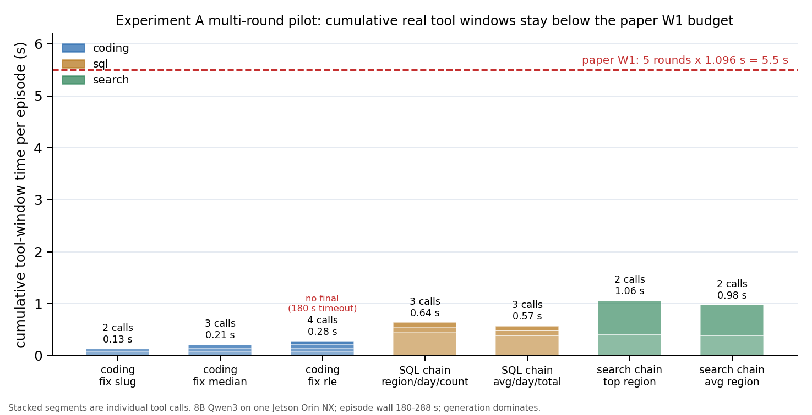

# 实验 A 补充：多轮任务的累计窗口（2026-10-19）

## 1. 结论

**多轮任务把累计窗口从单轮的 0.1–0.7 s 提高到 0.13–1.06 s，但仍远低于论文 W1 的 5×1.096 s ≈ 5.5 s。**

- 7 个多轮 episode、19 次真实工具调用；每 episode 2–4 次调用。
- 累计工具窗口：coding fix 0.13/0.21/0.28 s；SQL 链 0.57/0.64 s；跨工具 search 链 0.98/1.06 s。
- 单次调用：coding 微测试 64–74 ms；SQL 首次全表聚合 394–446 ms、后续索引查询 87–101 ms；search 588–647 ms。
- episode wall 180–288 s，工具时间只占 0.07–0.52%；8B 单机生成占绝对主导。
- 7 个 episode 中 6 个完成；`coding_fix_rle` 在第 6 轮 180 s 客户端超时，无 final，但 4 次工具调用仍计入。



## 2. 方法

- 同一套 harness / 工具 / 8B Qwen3 单机（nx1，context 2048，`/no_think`，think 剥离）。
- 新增 `--suite multi` 任务：
  - **coding fix**：给一段有 bug 的 starter code，模型必须调用 `run_tests` 迭代修复（slug / RLE / median）。
  - **SQL chain**：显式要求 3 次 `sql_query`：(1) 最高销售 region / 最高平均 region；(2) 该 region 的最高销售日；(3) 该 region+day 的计数/总额。
  - **search chain**：先用 `sql_query` 找 region，再用 `search_docs` 找该 region 的首府（跨工具 2 次调用）。
- `min_tool_calls` 强制最少调用次数；未达到时只提示继续，不伪造答案。
- SQL DB 的 region 改为 `R00000x`，与 120k 文档语料对齐；否则 SQL 结果无法用于 search。

## 3. 结果

| episode | workload | calls | 累计窗口 | 完成 | 最终答案 |
|---|---|---:|---:|---|---|
| coding_fix_slug | coding | 2 | 0.133 s | 是 | done（2/2 测试） |
| coding_fix_median | coding | 3 | 0.213 s | 是 | done（2/2 测试） |
| coding_fix_rle | coding | 4 | 0.275 s | 否（180 s 超时） | — |
| sql_chain_region_day_count | sql | 3 | 0.642 s | 是 | `R000005\|2025-12-18\|2381` |
| sql_chain_avg_region_total | sql | 3 | 0.573 s | 是 | `R000005\|2025-12-18\|1218470.02` |
| search_chain_top_region | search | 2 | 1.059 s | 是 | `City_000005` |
| search_chain_avg_region | search | 2 | 0.976 s | 是 | `City_000005` |

### 3.1 单次窗口的结构

- **coding fix**：测试是微函数（slug/RLE/median），每次 `run_tests` 只有 64–74 ms；4 次调用累计 0.28 s。真实项目测试套件通常更慢，这是**下界**，不是普遍值。
- **SQL**：第一次全表 `GROUP BY` 394–446 ms；拿到 region 后，带索引的 day/count/total 查询只要 87–101 ms。**第一个窗口贡献了 70% 以上的累计机会**。
- **search chain**：SQL 411/388 ms + search 647/588 ms；跨工具链的累计接近 1 s，是最接近论文单个 1.1 s 窗口的形态，但仍不到其 1/5（按 5 轮计）。

### 3.2 与论文 Fig.5 的对照

- 论文 W1：5 个 tool window，中位 1.096 s，累计约 5.5 s；W2/W3 约 1.2 s/窗口。
- 本轮：2–4 个窗口，累计 0.13–1.06 s；即使取最长的 search chain，也只有论文 W1 的 ~19%。
- 结论不是“机会不存在”，而是**论文的 5.5 s 累计预算需要 5 个接近秒级的窗口；本轮真实本地任务只提供 0.1–1 s 的累计窗口**。要把论文的预算成立，需要证明目标 workload 的工具窗口确实接近 1 s（远程 API、真实项目测试套件、长检索），而不是用本地微工具。

## 4. 限制

- 仍是单机 8B，不是 14B 5 机；episode wall 180–288 s，生成时间远大于论文的 14B 并行环境，工具占比被压低。
- 样本 7 个 episode、19 次调用；不足以估 p95。
- coding 测试是微测试；真实 coding agent 的测试套件可能 1–10 s，会显著改变累计窗口。需要补大测试套件（如 matrix 200×200、1M 行日志解析）作为上界。
- 本地工具无网络；远程搜索/抓取可能把窗口拉长到秒级，也可能因超时更不稳定。
- `coding_fix_rle` 的 180 s 超时是客户端 deadline，不是工具失败；该 episode 不计完成。
- 8B 生成随上下文增长明显变慢（38→154 s），影响了 episode wall；这是单机 8B 的现象，不是 14B 5 机的结论。

## 5. 对 B 的含义

- B 的准备预算不能假设“每 episode 有 5.5 s 窗口”。本轮真实任务是 0.1–1 s 累计；如果一次候选准备需要数百毫秒（B 要实测），一个 episode 只够准备 1–2 个候选。
- 第一个复杂查询/工具调用贡献大部分窗口；JIT/admission 应优先在这个窗口准备，后续小窗口只够增量。
- 需要把“窗口分布”作为 B 的输入变量，扫 0.1/0.5/1/2/5 s 五档，而不是固定 1.1 s。
- 如果 14B/5 机或大测试套件把累计窗口拉到秒级，B 的收益区间会明显变宽；这是下一步要确认的。

## 6. 证据与复现

- Harness：`scripts/experiments/opportunity_study.py`（`--suite multi`）。
- 原始数据：`work/opportunity_20261019/runs/multi_8b/`（7 个 `episode.json` + `summary.json`）。
- 图：`docs/test_records/assets/experiment_a_cumulative_windows_20261019.png`。
- 复现：
  ```bash
  python3 scripts/experiments/opportunity_study.py --prepare-fixtures
  python3 scripts/experiments/opportunity_study.py \
    --api-url http://127.0.0.1:19690/v1 --suite multi \
    --workloads coding,sql,search --limit 7 --max-turns 6 --max-tokens 192 \
    --out work/opportunity_20261019/runs/multi
  ```

## 7. 下一步

1. **大测试套件上界**：给 coding fix 任务加 1–5 s 的真实计算测试，测 coding 窗口的上界。
2. **14B/5 机**：解决 nano OOM 后重跑同样 7 个任务，确认窗口分布是否随模型/拓扑变化（工具侧应基本不变，但 episode wall/并发会变）。
3. **远程工具**：加真实 HTTP 检索，测网络延迟把窗口拉长到秒级的条件。
4. 把多轮窗口分布交给 B，作为准备预算的输入；B 的 pilot 先扫 0.1/0.5/1/2/5 s。
