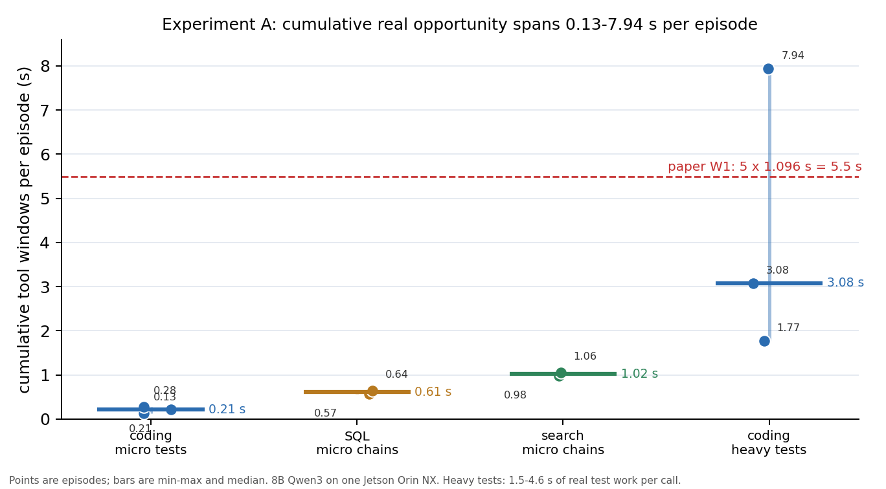

# 实验 A 上界：1–5 s 大测试套件的累计窗口（2026-10-20）

## 1. 结论

**机会的上界取决于工具本身。把 coding 测试从微测试换成 1.5–4.6 s 的真实计算后，单次窗口达到 0.57–4.01 s，累计达到 1.78–7.94 s；其中 top_k 的 7.94 s 已超过论文 W1 的 5.5 s。**

- 参考测试耗时（正确解）：matrix 3.06 s、top_k 4.56 s、logparse 1.51 s。
- 8B agent 实际调用：matrix 3.08 s（一次通过）；top_k 3.93 + 4.01 s（两次失败）；logparse 0.57 + 0.58 + 0.63 s（三次失败，且失败得很快）。
- 累计：matrix 3.08 s、top_k 7.94 s、logparse 1.78 s；1/3 完成（matrix 通过，top_k/logparse 模型写错）。
- 与微测试合并后，实验 A 的累计机会范围是 **0.13–7.94 s**。论文 W1 的 5.5 s 落在范围内，但**不是普适中位数**。



## 2. 方法

- 在 `--suite heavy` 下新增三个 coding 修复任务，starter code 故意有 bug：
  - `coding_heavy_matrix`：180→360 阶矩阵乘法（测试 360×360）。
  - `coding_heavy_topk`：3M→8M 整数取 top-200。
  - `coding_heavy_logparse`：3.5M→6M 行日志解析，测试重复 3 次。
- 测试的真实计算发生在断言之前（生成矩阵/排序/构造日志），因此即使模型解错，工具窗口也包含一部分真实工作；但若模型代码快速抛异常，窗口会缩短（logparse 就是这种情况）。
- 工具超时从 12 s 提高到 30 s，避免 4–5 s 测试被误杀。
- 仍为单机 8B Qwen3、context 2048、`/no_think`、最小工具调用 1 次。

## 3. 结果

| episode | calls | 每次窗口 | 累计 | 完成 | 说明 |
|---|---:|---|---:|---|---|
| coding_heavy_matrix | 1 | 3.08 s | 3.08 s | 是 | 一次修复正确，1/1 测试通过 |
| coding_heavy_topk | 2 | 3.93 / 4.01 s | 7.94 s | 否 | 模型返回升序 top-k，两次都失败 |
| coding_heavy_logparse | 3 | 0.57 / 0.58 / 0.63 s | 1.78 s | 否 | 解析逻辑错误；测试在第一次调用就抛异常，窗口缩短 |

- 6 次工具调用，p50 0.63 s、p95 4.01 s、max 4.01 s。
- 工具时间占 episode wall 中位 1.86%；episode 仍以 8B 生成为主（p50 56 s/generation）。
- 三个 episode 都出现了 `premature_final`：模型先想直接答 done，被 harness 要求至少调用一次工具后才继续。

## 4. 关键观察

1. **“机会是否真实”的答案是条件式的**：微测试下界 0.13–0.28 s/ episode，大测试上界 7.94 s/ episode；同一 workload 内差 50 倍以上。论文不能用单一中位数代表所有 agent 任务。
2. **失败模式会影响窗口**：模型快速抛异常时窗口缩短（logparse 0.6 s），而计算量大的错误解仍会跑满窗口（top_k 4 s）。所以“窗口长度”不仅取决于测试套件，也取决于模型行为。
3. **论文 W1 的 5.5 s 是可达的**：top_k 两次 4 s 调用就超过；但这要求测试套件本身是秒级、且 agent 会迭代 2 次以上。微测试 coding 和本地快速 SQL 达不到。
4. **累计窗口与完成率解耦**：top_k 累计最长但任务失败；logparse 累计短且失败。不能用“窗口大”推断“任务成功”，B 必须同时报告质量/成功率。

## 5. 限制

- 8B 单机、3 个 heavy episode、每个 1–3 次调用；样本小，不能估 p95。
- 测试是合成负载（矩阵/排序/日志），不是某个真实项目的测试套件；真实项目可能更慢或更快。
- 模型完成率低（1/3），且失败模式会改变窗口；这不是 agent 质量基准。
- 本地工具无网络；远程工具可能进一步拉长窗口，也可能超时。
- 14B/5 机仍未复核；工具侧窗口应相近，但 episode wall、并发与 bubble 会不同。

## 6. 对 B 的含义

- B 的准备预算必须扫 **0.1 / 0.5 / 1 / 2 / 5 / 8 s** 六档，而不是固定 1.1 s。
- 论文应把“1.096 s 中位”限定为**秒级工具/测试套件**的 workload，并明确微工具/快查询下窗口只有 0.1–0.7 s。
- 如果目标 agent 的测试套件是秒级，5.5 s 累计预算成立；如果是快速本地工具，预算需要缩小 5–10 倍，准备策略也必须相应保守。
- top_k 的 7.94 s 说明“大窗口”确实能 funding 多个候选；下一步要在 B 里验证这能否转化为端到端收益。

## 7. 证据与复现

- Harness：`scripts/experiments/opportunity_study.py --suite heavy`。
- 原始数据：`work/opportunity_20261019/runs/heavy_8b/`（3 个 episode + summary）。
- 图：`docs/test_records/assets/experiment_a_opportunity_range_20261020.png`。
- 复现：
  ```bash
  python3 scripts/experiments/opportunity_study.py --prepare-fixtures
  python3 scripts/experiments/opportunity_study.py \
    --api-url http://127.0.0.1:19690/v1 --suite heavy --workloads coding \
    --limit 3 --max-turns 4 --max-tokens 256 \
    --out work/opportunity_20261019/runs/heavy
  ```

## 8. 下一步

1. **14B/5 机复核**（按用户顺序的第二步）：解决 nano1/nano2 OOM，用更小的 context 或 18/18/2/1/1 层分配；跑同一组重任务，测窗口是否稳定、episode wall 与 decode bubble。
2. 扩充 heavy 样本到每类 3–5 个任务，统计完成率与窗口分布。
3. 把 0.13–7.94 s 的范围作为 B 的输入；B 的 pilot 先扫 0.1/0.5/1/2/5/8 s。
