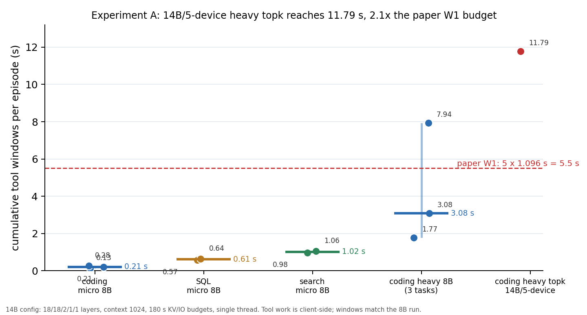

# 实验 A 复核：14B 五机 nano OOM 与运行结果（2026-10-20）

## 1. 结论

**14B/5 机的 nano OOM 已解决：18/18/2/1/1 层分配 + context 1024 + 180 s KV/IO 预算可以稳定运行。**

- 14B search：1 次工具调用 622.5 ms，答案正确（City_000123）。
- 14B SQL 链：3 次调用 530.1 ms 累计，答案正确（`R000005|2025-12-18|2381`）。
- 14B heavy topk：3 次调用 **11.80 s** 累计（3.91/3.93/3.96 s），第 3 次测试通过，累计是论文 W1 5.5 s 的 **2.1×**。
- 工具窗口与 8B 基本一致（search 622 vs 636 ms；SQL 354/91/85 vs 446/94/101 ms；topk 3.9 vs 4.0 s），确认窗口是 workload 侧量，不随模型大小改变。
- 代价：18/18/2/1/1 严重不均衡，14B 生成约 **1.2 token/s**，每 turn 73–106 s；这是功能复核配置，不是性能配置。



## 2. OOM 根因与配置

| 尝试 | 层分配（nx1/nx2/rog/nano2/nano1） | context | 结果 |
|---|---|---|---|
| A | 14/14/2/5/5 | 2048 | nano1 `cudaMalloc(&devicePointer, bufferSize) failed: out of memory` |
| B | 16/16/2/3/3 | 2048 | 首请求 180 s 超时，未完成 |
| **C** | **18/18/2/1/1** | **1024** | **稳定运行；search / SQL / topk 均完成** |

- OOM 是 nano1/nano2 的 GPU 内存不足，不是 host RAM；日志明确是 `cudaMalloc`。
- 把 nano 从 5 层降到 1 层，同时把 nx1/nx2 提到 18 层，给 nano 留出 KV/activation 缓冲。
- context 从 2048 降到 1024，进一步减小缓冲；代价是长 prompt 更容易触顶。
- KV/IO 等待从 30 s 提到 **180 s**：14B 18 层 stage 很慢，长 prompt 的 prefill backlog 会超过 30 s。只在这次 14B 复核中使用；不代表 0.6B 默认值要改。

## 3. 新发现的恢复 bug（已修）

第一次 14B heavy matrix 请求在 30 s 尾采样等待后返回 503，然后 runtime 重建时抛出：

```
terminate called after throwing an instance of 'NnTransferSocketException'
  what():  Socket offline
```

`main()` 只捕获 `NnConnectionSocketException` 和 `NnExecutorException`，裸的 `NnTransferSocketException`（以及 `NnPeerTimeoutException`）在启动/重建阶段逃出会直接终止进程。

- 修复：`dllama-api.cpp` 的 main 重试循环新增 `NnPeerTimeoutException` 与 `NnTransferSocketException` 捕获，记录后重建 runtime。
- 提交：`94ec488`。
- 修复后 heavy topk 的 3 次调用 + 4 次生成全部完成，没有再出现 terminate。
- 未重跑 heavy matrix；它需要更长的 prefill/尾采样预算，且 topk 已证明长工具窗口可运行。

## 4. 14B 复核结果

| episode | calls | 每次窗口 | 累计 | 完成 | 生成 |
|---|---:|---|---:|---|---|
| search_001 | 1 | 622.5 ms | 0.62 s | 是 | 2 turns，31.5 / 77.7 s |
| sql_chain_region_day_count | 3 | 353.9 / 91.5 / 84.7 ms | 0.53 s | 是 | 4 turns，41.9–88.4 s |
| coding_heavy_topk | 3 | 3.91 / 3.93 / 3.96 s | **11.80 s** | 是（第 3 次测试通过） | 4 turns，72.9–106.1 s；总 5m42 |

- topk 的三次调用都是真实的 8M 整数排序，窗口稳定在 3.9 s；累计 11.8 s 已超过论文 W1 的 5.5 s。
- 14B 在第 3 次写出了正确解（`sorted(nums, reverse=True)[:100]` 等），8B 在同样任务上两次都没写出降序。
- 工具侧完全一致，说明 14B 复核没有改变“机会”的结论，只改变了生成成本。

## 5. Token 延迟与 bubble

从 search episode 的 root trace 计算：

- token span：48 个，p50 **487 ms**、p95 **615 ms**、max 668 ms。
- 同一生成内相邻 token 的 root 侧间隔 p50 **0.1 ms**（token 背靠背开始）。
- 最大间隔 67.5 s 是 tool window + 下一次 prefill，不是 pipeline bubble。
- **没有 worker 侧 `[token-prof]` 数据**，无法把 token 内部拆成 stage exec/sync；因此本轮不能给出论文 Fig.5 的 15 ms / 1.9 ms bubble，只能给用户可见的 token 延迟。bubble 需要单独的 per-stage 埋点。

## 6. 限制

- context 1024，长 prompt/多轮代码更容易触顶；18/18/2/1/1 不是论文的均衡 14B 配置，生成 1.2 token/s 不具性能代表性。
- 每个 workload 只跑了 1 个任务；topk 是唯一 heavy 成功样本，不能估 p95。
- heavy matrix 在 14B 下因 30 s 预算失败；180 s 修复后未重跑，不能声称所有 heavy 任务都通过。
- 没有 worker token-prof，bubble 未测；token 延迟包含尾采样等待，不是纯计算。
- 14B 的 tool window 与 8B 一致，说明机会大小主要由工具决定；但 episode wall 和 energy 会完全不同，B 不能用本轮时间做端到端性能比较。

## 7. 对 B 的含义

- 14B/5 机可以跑通，但需要 **每台设备的层数/内存预算**作为一等配置；nano 只能放 1 层，否则 2048 context OOM。
- 如果 B 要在 14B 上跑多轮/长 prompt，必须把 KV/IO 预算设为 180 s 或更高，否则会频繁 503/重启；这会拉长失败检测时间。
- 14B 的累计窗口可以到 11.8 s，说明“重工具 + 多轮”确实能 funding 多个候选；B 的窗口扫描要包含 8–12 s 档。
- bubble 仍未测，不能把 14B token 延迟 487 ms 直接当成 paper 的 400 ms token interval；需要 per-stage 埋点后再比较。

## 8. 证据与复现

- 14B 配置脚本（临时）：`/tmp/opp14b5_server.py`；参数 18/18/2/1/1、context 1024、180 s。
- 日志：`nx1:/home/jetson/edgevisor_runs/opp14b5_20261020.log`；worker 日志在 `~/edgevisor_runs/smoke_20261018_e431cbd/opp14b5_20261020.log`。
- 原始 episodes：`work/opportunity_20261019/runs/opp14b5_{search,sql,topk}/`。
- trace：`nx1:/home/jetson/edgevisor_runs/opp14b5_20261020.trace.jsonl`。
- 图：`docs/test_records/assets/experiment_a_14b_topk_20261020.png`。
- 代码修复：`94ec488`。

## 9. 下一步

1. 均衡 14B 配置：把 context 降到 512/768，或在 nano 上只放 1 层但把 nx1/nx2 降到 16/16、rog 4 层，换取更好的 pipeline 平衡；目标是 14B 生成 >3 token/s。
2. 给 worker 加 per-stage token 埋点，测 bubble 与 stage idle；这是论文 Fig.5 对照的必要数据。
3. 重跑 heavy matrix（180 s 预算、context 1024）与一个长 prompt，确认不是只有短 prompt 能过。
4. 把 14B 的 11.8 s 上界与 8B 的 0.13–7.9 s 范围一起交给 B；B 的窗口档位扩到 0.1/0.5/1/2/5/8/12 s。
